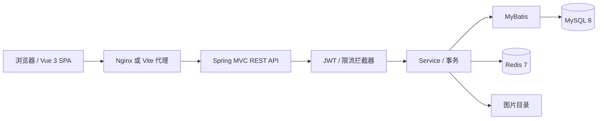
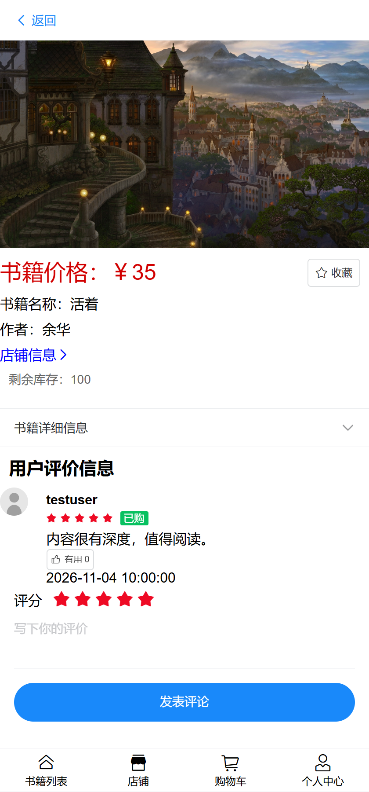
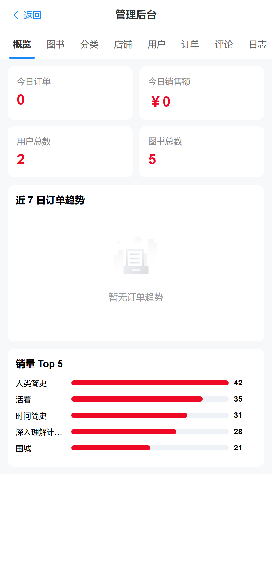
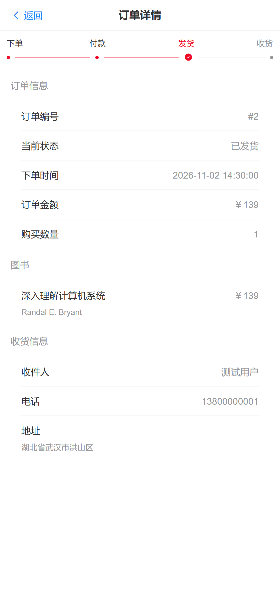

# Bookshop 书城系统

[](https://github.com/OWNER/REPO/actions/workflows/ci.yml)


[](LICENSE)

一个前后端分离的单体书城系统，覆盖图书浏览与搜索、购物车、订单状态机、沙箱支付与退款、收货地址、评论评分/点赞/商家回复、站内通知、管理看板，以及 JWT 吊销、分布式限流、上传内容校验、下单幂等和 Docker 部署。

发布前请将徽章中的 `OWNER/REPO` 替换为实际 GitHub 仓库地址。

## 功能

- 用户：注册、登录、修改资料/头像、找回密码、JWT 刷新与即时吊销。
- 图书与店铺：分类浏览、搜索排序、搜索历史、Redis 缓存。
- 交易：购物车合并结算、库存原子扣减、订单状态机、沙箱支付、退款、物流信息。
- 互动：收藏、评分评论、评论点赞、已购徽章、管理员回复。
- 个人中心：地址簿、订单详情时间线、站内通知与未读角标。
- 管理后台：图书/分类/店铺/用户/订单/评论管理、统计看板、操作日志。
- 工程安全：BCrypt、JWT `token_version`、Redis Lua 滑动窗口限流、图片魔数与 ImageIO 校验、数据库幂等键。

## 架构



关键设计：

- 双 Spring 容器：root 容器管理 service、数据源和 Redis；MVC 子容器管理 controller、advice、拦截器。
- 订单与购物车结算使用条件更新和事务，保证库存、销量和状态一致。
- Redis 缓存或限流不可用时自动降级数据库/进程内限流，不阻断核心业务。

## 功能截图

| 首页 | 图书详情与评论 |
|---|---|
|  |  |

| 购物车结算 | 管理看板 | 订单详情 |
|---|---|---|
|  |  |  |

截图来自本地演示数据；可运行 `npm run dev` 后重新生成。

## 快速开始

### 方式一：Docker Compose（推荐）

```bash
cp .env.example .env
# 修改 .env 中的数据库密码和 JWT_SECRET
docker compose up --build
```

打开 <http://localhost:8080>。Compose 会启动 MySQL 8、Redis 7、Tomcat 9 后端和 Nginx 前端，并自动导入 `bookshop.sql`。

冒烟测试可指向容器映射端口：

```bash
SMOKE_BASE=http://localhost:8080/api node smoke-test.mjs
```

### 方式二：本地手动启动

要求：JDK 8/17、Maven 3.6+、MySQL 8、Node.js 18+。Redis 可选。

1. 创建数据库并导入演示数据：

```bash
mysql -uroot -p < bookshop.sql
```

2. 准备后端配置：

```bash
cd javaEEProject4/src/main/resources
cp jdbc.properties.example jdbc.properties
cp jwt.properties.example jwt.properties
cp pic.properties.example pic.properties
cp mail.properties.example mail.properties
cp redis.properties.example redis.properties
```

配置项支持环境变量覆盖，也可直接修改本地 properties。`jwt.secret` 至少需要 32 字节，生产环境可用：

```bash
openssl rand -base64 48
```

3. 启动后端：

```bash
cd javaEEProject4
mvn tomcat7:run
```

API 根路径为 <http://localhost:8090/project1>。

4. 启动前端：

```bash
cd vue
npm ci
npm run dev
```

浏览器访问 <http://localhost:5173>，Vite 会代理 `/api` 与 `/pic`。

### 演示账号

| 用户名 | 密码 | 说明 |
|---|---|---|
| `testuser` | `123456` | 普通用户 |
| `admin` | `123456` | 管理员 |

演示账号仅用于本地/公开演示，生产环境应修改或移除。

### 演示数据

文学 / 计算机 / 历史 / 科学 / 艺术五大板块各 72 本书（共 360 本）、各 8 家店铺（共 40 家）。
图书封面命名 `b1.jpg`–`b360.jpg`、店铺图 `s1.jpg`–`s40.jpg`，均为程序生成的占位图
（`node tools/gen-placeholder-images.mjs` 可再生成）；文件名与书名/店名的对照表见
[`docs/图片需求清单.md`](docs/图片需求清单.md)，替换真实图片按文件名覆盖即可，缺图时前端自动回退默认图。

## 数据库升级

已初始化数据库请按顺序执行：

```text
bookshop-p0-migration.sql
bookshop-p1-migration.sql
bookshop-p2-migration.sql
bookshop-p3-migration.sql
bookshop-p5-migration.sql
bookshop-p7-migration.sql
```

P4/P6 没有数据库结构变更；P7 为演示数据扩容（360 书 / 40 店）与图片改名，同样无结构变更。全新安装直接导入 `bookshop.sql`。

## 生产配置

关键配置均支持环境变量：

| 环境变量 | 说明 | 默认 |
|---|---|---|
| `JDBC_URL` | MySQL JDBC URL | 本地 `bookshop` |
| `JDBC_USERNAME` / `JDBC_PASSWORD` | 数据库账号 | `root` / 本地开发值 |
| `JWT_SECRET` / `JWT_EXPIRE_MINUTES` | JWT 密钥与有效期 | 开发占位值 / 720 |
| `PIC_DIR` | 图片保存目录 | `../picture` |
| `REDIS_ENABLED` / `REDIS_HOST` | Redis 开关与地址 | `true` / `localhost` |
| `MAIL_ENABLED` / `MAIL_HOST` | 找回密码邮件 | `false` / 示例 SMTP |
| `CORS_ALLOWED_ORIGINS` | 允许来源，逗号分隔 | 空（关闭 CORS） |

`mail.enabled=false` 时不会发信，验证码写入 `javaEEProject4/logs/bookshop.log`，便于开发联调。

## 订单状态机

```text
0 待付款 -> 1 已付款 -> 2 已发货 -> 3 已收货
      \          \
       -> 5 已取消
                  -> 6 已退款
4 交易成功（历史演示终态）
```

- 付款写 `payment` 记录；退款仅允许已付款且未发货订单。
- 取消或退款回补库存；已付款后取消/退款同时回滚销量。
- 所有状态流转使用 `where state = 期望状态` 条件更新，并发下只有一个请求成功。
- `requestId` 唯一键配合事务实现下单/购物车结算幂等。

## 安全设计

- 密码使用 BCrypt；历史 MD5 用户在首次成功登录时自动重哈希。
- JWT 携带 `token_version`；改密、重置密码、封禁/解封后旧 token 立即失效。
- 登录、注册、发送找回密码验证码按 IP 滑动窗口限流；有 Redis 时使用 Lua 原子脚本，无 Redis 时降级内存实现。
- 上传文件同时校验扩展名、文件魔数、扩展名与真实类型一致性、ImageIO 可读性和 2MB 上限。
- 归属信息取自 JWT，不信任客户端 `uid`；管理操作校验 `type=2`。
- 对外接口通过 `@JsonIgnore` 和专用公开查询避免返回密码哈希。

## 测试与 CI

```bash
# 后端单测与编译
cd javaEEProject4 && mvn test

# 前端生产构建
cd vue && npm run build

# 后端启动后执行 HTTP 冒烟
node smoke-test.mjs
```

当前 HTTP 冒烟共 **226 项断言**，覆盖 P0–P5 主流程、越权、事务回滚、并发状态保护、支付退款、地址上限、评论点赞、通知、找回密码、上传伪造检测和 5 并发幂等。JUnit 5 + Mockito 覆盖订单状态机、购物车失败路径、密码兼容、校验工具、限流窗口和验证码过期。

冒烟会在库中留下测试用户/订单/日志等残留。恢复演示基线：

```bash
npm install mysql2 --no-save   # 仓库根目录，仅清理脚本需要
node smoke-cleanup.mjs
```

GitHub Actions 在 MySQL 8 服务容器中导入 `bookshop.sql`，执行 Maven 测试、前端构建和 HTTP 冒烟。

## API 文档

完整 OpenAPI 3.0 文档见 [`docs/openapi.yaml`](docs/openapi.yaml)。可使用任意 OpenAPI 查看器导入，或：

```bash
npx @redocly/cli preview-docs docs/openapi.yaml
```

统一响应：

```json
{ "code": 1, "msg": "success", "data": {} }
```

`code=1` 成功、`code=0` 业务失败。鉴权失败返回 HTTP 401，限流返回 HTTP 429。

## 技术亮点

1. **订单状态机与并发控制**：条件更新保证 5 个并发付款请求仅 1 个成功；库存扣减使用带库存条件的原子 SQL。
2. **购物车事务结算**：每条商品复用订单创建逻辑，任一商品下架/库存不足时订单、库存和购物车全部回滚。
3. **安全链路**：BCrypt 懒迁移、JWT `token_version` 即时吊销、Redis Lua 限流、图片读取校验、请求幂等键共同覆盖认证、防刷、上传和重复提交风险。
4. **工程化交付**：226 项 HTTP 自动化检查、JUnit 单测、GitHub Actions、Docker Compose、Redis 降级和 OpenAPI 文档。

面试复盘建议：每个亮点准备“为什么这样做、替代方案、并发或故障边界、如何验证”四个问题。

## 项目结构

```text
bookshop/
├── javaEEProject4/                 # Spring MVC + MyBatis war 后端
├── vue/                            # Vue 3 + Vite + Vant SPA
├── picture/                        # 图片目录
├── docs/                           # OpenAPI 与部署示例
├── .github/workflows/ci.yml        # CI
├── docker-compose.yml              # MySQL + Redis + backend + nginx
├── bookshop.sql                    # 全量初始化
├── bookshop-p*-migration.sql       # 增量迁移
├── tools/                          # 演示占位图生成脚本
└── smoke-test.mjs                  # HTTP 冒烟测试
```

## Changelog

见 [`CHANGELOG.md`](CHANGELOG.md)。

## License

[MIT](LICENSE)
